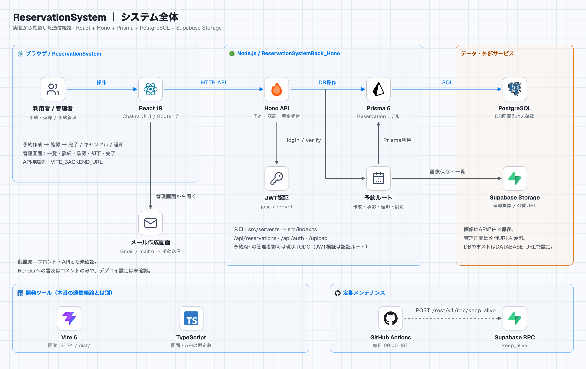
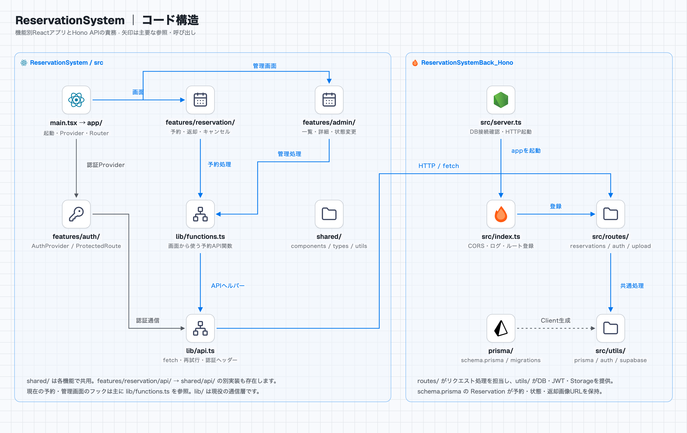

# 予約システム

モダンな React アプリケーション構成でリファクタリングされた予約システムです。

## システム構成

このリポジトリは予約・返却・管理画面を提供するReactフロントエンドです。HonoのHTTP APIを呼び出し、バックエンドがPrisma経由でPostgreSQL、画像保存にSupabase Storageを利用します。

<picture>
  <source media="(prefers-color-scheme: dark)" srcset="docs/architecture/overview-dark.png">
  
</picture>

### コードの構造

`app/` が画面全体を組み立て、`features/` が予約・認証・管理機能、`shared/` が共通UI・型・定数を担当します。主要な予約・管理処理は現在も `lib/functions.ts` と `lib/api.ts` を利用しています。

<picture>
  <source media="(prefers-color-scheme: dark)" srcset="docs/architecture/structure-dark.png">
  
</picture>

[図の根拠・補足・再生成手順](docs/architecture/README.md) · [全体図のHTML](docs/architecture/index.html) · [コード構造のHTML](docs/architecture/structure.html)

HTMLはローカルでブラウザから開くと配色を切り替えられます。GitHub上では上の画像で閲覧できます。図は2026-11-03時点のソースに基づき、デプロイ先など未確認の情報は図中に明記しています。

## ディレクトリ構成

```
src/
├── app/                         # アプリケーションレベルの設定
│   ├── providers/               # グローバルプロバイダー
│   │   └── AppProviders.tsx     # ChakraUI + AuthProvider
│   ├── router/                  # ルーティング設定
│   │   └── AppRoutes.tsx        # ルート定義
│   ├── layout/                  # レイアウトコンポーネント
│   │   └── PageLayout.tsx       # ページレイアウト
│   └── App.tsx                  # メインアプリコンポーネント
├── features/                    # 機能別ディレクトリ
│   ├── auth/                    # 認証機能
│   │   ├── components/          # 認証関連コンポーネント
│   │   ├── hooks/               # 認証関連フック
│   │   └── index.ts             # 機能のエクスポート
│   ├── reservation/             # 予約機能
│   │   ├── pages/               # 予約関連ページ
│   │   ├── components/          # 予約関連コンポーネント
│   │   ├── api/                 # 予約API
│   │   └── index.ts             # 機能のエクスポート
│   └── admin/                   # 管理機能
│       ├── pages/               # 管理画面ページ
│       ├── components/          # 管理画面コンポーネント
│       └── index.ts             # 機能のエクスポート
├── shared/                      # 共有リソース
│   ├── components/              # 共有コンポーネント
│   │   ├── ui/                  # 基本UIコンポーネント
│   │   └── form/                # フォーム関連コンポーネント
│   ├── hooks/                   # 共有フック
│   ├── utils/                   # ユーティリティ関数
│   ├── api/                     # 共有API設定
│   ├── types/                   # 型定義
│   └── constants/               # 定数
└── lib/                         # 現在の主要なAPI呼び出し・通信ヘルパー
```

## 機能

### 認証システム

- JWT トークンベースの認証
- ローカルストレージでのセッション管理
- 保護されたルートのサポート

### 予約システム

- 予約の作成、確認、完了
- 利用可能時間の表示
- 返却処理

### 管理システム

- 予約一覧の表示
- ページネーション
- 予約の承認/却下/削除

## 技術スタック

- **React 19** with TypeScript
- **Chakra UI v3** for UI components
- **React Router v7** for routing
- **React Hook Form** for form management
- **Vite** for build tooling

## 開発

```bash
# 開発サーバー起動
npm run dev

# ビルド
npm run build

# プレビュー
npm run preview

# 型チェック
npm run type-check
```

## パスエイリアス

```typescript
@/*          -> ./src/*
@/features/* -> ./src/features/*
@/shared/*   -> ./src/shared/*
@/app/*      -> ./src/app/*
@/hooks/*    -> ./src/hooks/*
```

## 設計原則

1. **Feature-based Architecture**: 機能ごとの独立性
2. **関心の分離**: ビジネスロジック、UI、API の分離
3. **再利用性**: 共有コンポーネントとユーティリティ
4. **型安全性**: TypeScript による厳密な型チェック
